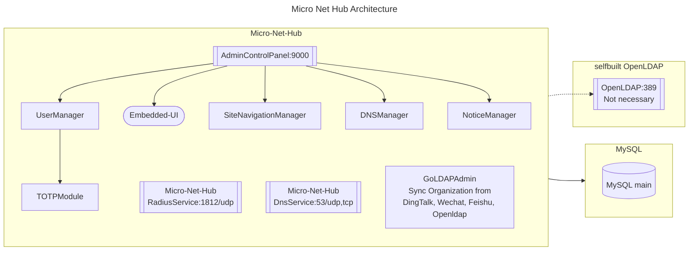

<!-- @format -->

A tool for managing your OpenLDAP/DNS/Navigation at a private network.

# How to install Micro-Net-Hub

just for functional experience
```
git clone https://github.com/bagechashu/micro-net-hub.git
cd micro-net-hub/docs/docker-compose/simple

# config/app/conf/ holds config.yml, the RSA keys (generated on first start) and rotation backups;
# the container runs as uid 1000
sudo chown -R 1000:1000 config/app/conf

# Install "docker" first; If you use old version "docker", install "docker-compose" also.
docker compose up -d

```

[Installation Manual](docs/README.md) · [Release notes](RELEASE.md)

# RSA key and key rotation

Micro-Net-Hub uses an RSA key pair to encrypt the passwords sent by the login form and to store user passwords.

- **New deployment**: the key pair is generated on first start (2048-bit), as long as the key files don't exist and the database has no users yet. With docker-compose the keys go to `config/app/conf/`, next to `config.yml`. **Back up this directory**: if the keys are lost, existing users can no longer log in.
- **Existing deployment**: if the service logs `当前使用的是仓库里提交过的公开 RSA 密钥` at startup, it still uses the public key pair that used to ship with this repository. Rotate it:

  ```shell
  # docker-compose: stop the service, check first, then rotate, then start
  docker compose stop micro-net-hub
  docker compose run --rm micro-net-hub ./micro-net-hub rotate-rsa-key --dry-run
  docker compose run --rm micro-net-hub ./micro-net-hub rotate-rsa-key
  docker compose start micro-net-hub

  # binary
  ./micro-net-hub-linux-amd64 rotate-rsa-key --dry-run
  ./micro-net-hub-linux-amd64 rotate-rsa-key
  ```

  Rotation generates a new key pair, re-encrypts every stored user password and the encrypted passwords in `config.yml`, and backs up the old keys and config to `rsa-backup-<time>/` next to the private key (with docker-compose: `config/app/conf/rsa-backup-<time>/` on the host). **Users keep their passwords**; LDAP passwords are not touched.
- **Passwords in `config.yml`** (`ldap.admin-pass`, `ldap.user-init-password`) can be written in plain text with the `plain:` prefix, e.g. `admin-pass: "plain:your-password"`, or as ciphertext encrypted with this deployment's public key.

- **Config directory**: the service reads `config.yml` from the `conf/` directory next to the binary (`/app/conf/` in the container), or from the directory given with `-conf <dir>` (e.g. `micro-net-hub -conf /etc/micro-net-hub`, also `rotate-rsa-key -conf <dir>`). Without `-conf` it falls back to `config.yml` next to the binary, then `conf/config.yml` / `config.yml` in the working directory (for `go run`). Relative paths in `config.yml` (RSA keys, `site-logo`) are relative to the directory of `config.yml`; `logs.path` and the sqlite `database.source` stay relative to the working directory.

More details: [Installation Manual → RSA key](docs/README.md#rsa-key).

# How to set Ocserv Authentication with Radius which build in Micro-Net-Hub.

[Click to see the doc](backend/internal/radiussrv/README.md)

# How to set OpenLdap and IM manager

[Go-LDAP-Admin - eryajf](http://ldapdoc.eryajf.net/pages/5683c6/#%E5%88%9D%E5%A7%8B%E6%95%B0%E6%8D%AE)

# References

- https://github.com/eryajf/go-ldap-admin
- https://github.com/gnimli/go-web-mini
- https://github.com/LyricTian/gin-admin
- https://github.com/go-admin-team/go-admin
- https://github.com/m-vinc/go-ldap-pool
- https://github.com/bjdgyc/anylink
- https://github.com/fivexl/golang-radius-server-ldap-with-mfa
- https://github.com/lework/lenav
- https://github.com/kenshinx/godns
- https://github.com/snail2sky/coredns_mysql_extend.git 

# Architechture


